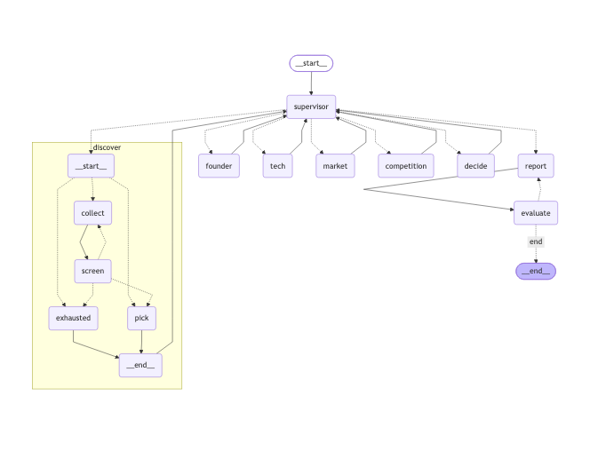

# AgTech 스타트업 투자 평가 에이전트
본 프로젝트는 AgTech(스마트팜·농업 AI) 분야의 비상장 스타트업을 공개 정보로 발굴하여,
창업자·시장성·제품/기술·경쟁·실적·투자조건 관점에서 평가하는 Supervisor 패턴 기반 멀티 에이전트를 설계/개발하는 프로젝트임.

## Overview
- **Objective** : 분야를 정하면 그 분야의 Seed~Series C 스타트업을 발굴하고, 후보마다 여러 관점에서 근거를 모아 **투자 / 보류**를 판단하는 보고서 작성
- **Pattern** : Supervisor — 분석 에이전트끼리 결과를 이어 받는다(시장은 기술 뒤, 경쟁은 창업자·기술 뒤). 작업을 미리 쪼개 병렬로 돌리는 Orchestrator 보다, 결과를 보고 다음 작업과 재조사를 정하는 Supervisor 가 맞다
- **동적 처리** : 순서를 코드에 고정하지 않는다. Supervisor 가 State(관점별 진행 상태·근거)를 보고 다음 에이전트를 고르고, 네 관점이 모이면 근거 충분성을 검토해 부족한 관점만 새 검색어로 재조사시킨다. 재조사 후에도 부족한 후보는 빼지 않고 '근거 부족' 보류로 채점해 비교표·동종 기준 집단에 남긴다

## Features
- **발굴** : 투자 뉴스·공공 프로그램·스타트업 DB·수상·해외 투자 뉴스 등 8개 채널과 TIPS 공개 목록에서 후보 수집, 여러 채널에서 잡힌 후보 우선
- **적격성 관문** : 비상장(거래소 목록 대조) · Seed~Series C · Exit 전 · 부정 신호 없음 · 대상 분야(LLM 이 주력 분야를 고르고 코드가 판정) · 최소 근거량
- **PDF 자료 기반 정보 추출** : 공공·연구기관 문서 15종 199쪽을 Agentic RAG(검색 → 관련성 채점 → 질의 재작성 → 웹 보완 → 인용 답변 → 근거 점검)로 검색
- **평가** : Scorecard 6개 기준(창업자 30 · 시장성 25 · 제품/기술 15 · 경쟁 10 · 실적 10 · 투자조건 10) × 4문항 = 24문항, Bessemer 체크리스트 10문 대응. 동종 기준 집단 평균 대비 배수 M > 1.00 이면 투자
- **확증 편향 방지 전략** : LLM 은 문항마다 판정과 원문 인용만 답하고 점수·결론은 코드가 낸다. 인용이 근거 본문에 없거나, 회사명이 인용 주변에 없거나, 회사 자체 발표뿐이면 YES 를 미확인으로 강등. 기준별로 따로 판정해 후광 효과를 막는다
- **보고서 품질 평가** : Groundedness · 중립성 · 편향 통제를 규칙 검사 + LLM Judge 로 평가, 미달이면 보고서 재작성 (아래 [보고서 품질 평가](#보고서-품질-평가))

## Tech Stack
- **Framework** : LangGraph
- **LLM/Generator** : gpt-4.1-mini
- **LLM/Judge** : gpt-4.1-mini
- **Retrieval** : FAISS + Kiwi BM25 하이브리드(0.4 : 0.6) — Hit@4 0.986, MRR@4 0.831 (검색 평가 70문항)
- **Embedding** : nlpai-lab/KURE-v1

## Agents
| 에이전트 | 역할 |
|---|---|
| **Supervisor** | 다음 에이전트 선택(선행 관점이 끝난 것 중 LLM 이 우선순위 판단) · 근거 충분성 검토 · 재조사 지시 · 근거 부족 보류 판정 · 실행 실패 후보 제외 · 보고서 작성 승인 |
| discover | 탐색 서브그래프: collect(발굴) → screen(적격성 관문) → pick(평가 대상 선택) |
| founder | 창업 시점·창업 전 경력·창업 후 마일스톤 → 창업자 기준 판정 |
| tech | 제품·핵심 기술·장단점·차별점 주장, 분야 기술 기준선(RAG) → 제품/기술 기준 판정 |
| market | 세부 분야 시장 규모·성장·수요(질의 분해 + Agentic RAG) → 시장성 기준 판정 |
| competition | 같은 제품 유형 경쟁사 비교, 차별점 주장 검증 → 경쟁 우위 기준 판정 |
| decide | 실적·투자조건 판정, 동종 대비 배수·결정·뒤집힘 조건·실사 항목 |
| report | SUMMARY·본문·REFERENCE 보고서(PDF) 작성 |
| evaluate | 보고서 품질 평가, 미달이면 report 로 되돌림 |

하위 에이전트는 Supervisor 가 정한 입력만 복사해 받고 결과만 돌려준다. 하위 에이전트끼리 직접 간선이나 호출은 없다.

## State Schema
`graph/state.py` 의 `InvestmentState` 를 ① 작업 페이로드 · ② 제어 메타 · ③ 추적·복구 세 묶음으로 나눴다.

- **제어 vs 페이로드 분리** : 에이전트 결과(founder·tech·market·competition·evaluations·report 등)는 ①, 라우팅·종료 판단에 쓰는 값은 ②에 둔다. Supervisor 는 ②의 `view_progress`(관점별 status·attempts·missing·source_ids)로 다음 노드를 고른다
- **관측성 위치** : 결정과 사유는 짧은 문자열로 `log` 에 남기고, 상세(충분성 판단 이유·재조사 검색어·품질 평가 이유)는 `run_log.json` 과 LangSmith 로 보낸다
- **지속성 비용** : 큰 원문은 근거 저장소 `registry` 한 곳(`merge_dict` Reducer)에만 둔다. 하위 에이전트 입력은 실행할 때 State 에서 복사해 만들고 State 에 저장하지 않는다
- **상관** : `run_id` 를 State · `run_log.json` · LangSmith metadata·태그 · checkpoint `thread_id` 에 같은 값으로 넣는다
- **재개/복구** : 재개에 필요한 최소 상태를 State 에 둔다 — 관점별 상태·시도 횟수·보완할 검색어(`view_progress`), 후보별 재조사 횟수, Supervisor 판단 횟수, 마지막 오류(`last_error`). 하위 에이전트가 실패하면 실행을 멈추지 않고 `last_error` 로 Supervisor 에 알리고, Supervisor 는 그 후보만 제외한다(Fallback: 제외). 다만 지금 실행은 checkpointer 를 연결하지 않아 **중단된 실행을 이어서 재개하지는 않는다**. `build_supervisor_graph(checkpointer=...)` 로 붙일 수 있게 열어 두었고, 붙이면 `run_id` 가 thread_id 가 된다. 대신 검색·LLM 응답 캐시(`cache_fresh/`) 덕분에 다시 실행하면 이미 끝난 호출은 재사용된다
- **동시 처리** : 누적 필드에 Reducer 를 둔다(`operator.add` · `merge_dict` · `add_unique`). Supervisor 는 한 번에 하나의 에이전트만 실행하므로 같은 필드를 동시에 쓰지 않는다
- **종료 보장** : Supervisor 판단 횟수 `supervisor_steps` ≤ `supervisor.max_steps`(넘으면 지금까지 평가한 후보로 보고서), 후보당 재조사 5회, 평가 후보 10곳, 보고서 재작성 2회, 마지막 안전장치로 `recursion_limit`

## 보고서 품질 평가
보고서를 만든 뒤 `evaluate` 노드(`agents/evaluator.py`)가 품질을 평가하고, 미달이면 보고서를 다시 쓰게 한다.

- **방식** : 3안 Hybrid. 항목마다 규칙 검사(1안)와 LLM Judge(2안)를 **둘 다** 통과해야 충족이고, 세 항목이 모두 충족이어야 통과
- **평가 항목** : Groundedness · 중립성 · 편향 통제
- **루프** : `report → evaluate ─(미달)→ report` · 미달 사유를 보고서 프롬프트에 넣어 다시 쓴다 · 최대 2회(`evaluation.max_revisions`), 상한에 닿으면 마지막 보고서와 평가 결과를 남기고 종료
- **기록** : `run_log.json` 의 `report_evaluation` (항목별 결과, 규칙 위반 목록, LLM Judge 이유, 재작성 횟수)

| 항목 | 규칙 검사 (1안) | LLM Judge (2안) |
|---|---|---|
| Groundedness | 본문 인용 번호 = REFERENCE 목록 · REFERENCE 형식 · 인용 없는 장 없음 · SUMMARY 장 참조(→n장)가 실제 장을 가리킴 · 결론 문장 = 평가표 결과 · ROI 가정 수치에 '가정' 표기 | 사실 주장마다 인용 번호가 있고 실제 출처를 가리키는가 |
| 중립성 | 평가표와 어긋난 단정 0건 · SUMMARY 금지 표현 없음 · SUMMARY 규칙(글자 수 등) 위반 없음 | 결론을 평가표 점수로 제시하고 근거 없는 우열 판정·과장·평가 형용사가 없는가, 회사 측 주장을 구분했는가 |
| 편향 통제 | 서로 다른 출처 3곳 이상 · 한 출처 비중 50% 이하 · 회사 자체 사이트가 아닌 출처 50% 이상 | 여러 출처를 쓰고 리스크·반대 근거를 함께 다뤘는가, 미확인 항목을 결론의 한계(실사 항목)로 밝혔는가 |

### 기준 강화
처음 버전으로 실행하니 SUMMARY 글자 수 초과(570자 > 560자)가 있어도 통과했다. 그래서 **다시 쓰면 고칠 수 있는 문제**를 기준에 더했다. 미확인 비율처럼 데이터 자체의 한계는 다시 써도 바뀌지 않으므로 미달 기준으로 쓰지 않고, 그것을 **밝혔는지**만 본다.

| 항목 | 추가한 기준 | 이유 |
|---|---|---|
| Groundedness | 장 참조 · 결론-평가표 일치 · ROI '가정' 표기 | 보고서 노드가 이미 계산하던 검사 결과인데 품질 판정에 쓰이지 않았다 |
| 중립성 | SUMMARY 규칙 위반 | SUMMARY 는 결론 요약이라 규칙 위반이 과장·누락으로 이어지기 쉽다 |
| 편향 통제 | 제3자 출처 비율 하한 (규칙), 미확인 항목을 한계로 밝혔는가 (LLM) | 출처 수만 보면 회사 자체 사이트 여러 페이지로도 통과할 수 있었다 |

기준값은 `config.yaml` 의 `evaluation` 에서 바꾼다.

> TODO: 과제 가이드의 '관점 커버리지'를 평가 항목에서 뺀 이유

## 설계 고민과 결정
에이전트 패턴을 입히면서 실제로 돌려 보고 바꾼 결정들이다. 수치는 2026-10-13 실행 기록(`run_log.json`, `cost_history.jsonl`) 기준.

| 고민 | 처음 | 바꾼 결정 | 이유 |
|---|---|---|---|
| 패턴 선택 | — | Orchestrator-Workers 대신 Supervisor | 에이전트끼리 결과를 이어 받아(시장은 기술 뒤, 경쟁은 창업자·기술 뒤) 관점 단위 병렬이 안 된다. 후보 단위 병렬은 가능하지만 후보 1곳 기준인 State 를 전부 다시 짜야 했다 |
| 순서를 누가 정하나 | — | 선행 관계는 코드 규칙, 실행 가능한 관점이 여럿일 때만 LLM 이 선택 | 순서를 하드코딩하지 않으면서도 LLM 이 불가능한 순서(기술 전에 시장)를 고르지 못하게 한다. 그래도 고르면 가능한 첫 관점으로 대체 |
| LLM 답이 형식을 어길 때 | `ValueError` 로 실행 전체 중단 | 보정하고 계속 진행 | 가짜 근거 ID 로 "충분"이라 하면 승인하지 않고 다시 묻는다. 실행은 멈추지 않되 근거 없는 승인은 막는다 |
| 근거가 끝까지 부족한 후보 | 실행 전체 중단(보고서 없음) → 후보 제외 | **'근거 부족' 보류로 채점** | 제외 방식으로 돌렸더니 9곳 중 7곳이 빠져 동종 기준 집단이 2곳(최소 5곳 미달)이 됐고, 점수가 동종 비교가 아닌 fallback 으로 계산됐다. 또 공개 정보가 많은 회사만 남는 편향이 생겼다. 빼지 않고 미확인을 0점으로 채점하면 비교 기준이 유지되고, 근거 부족 후보는 투자로 추천되지 않는다 |
| 재조사를 언제 멈추나 | 한도(2회)까지 무조건 반복 | 한도 5회 + **개선이 확인될 때만 재시도** | 검색 결과가 없어도 한도까지 같은 재조사와 재분석을 반복했다. 이제 재조사 뒤 네 관점의 미확인 문항 수가 줄지 않으면 LLM 검토 없이 바로 '근거 부족' 보류로 넘긴다. 한도는 최대치일 뿐 실제 횟수는 개선 여부가 정한다 |
| 재조사 근거의 범위 | 시장 분석 결과를 분야 단위 캐시로 공유 | 재조사 근거가 섞인 시장 분석은 캐시에 저장하지 않음 | 한 후보를 위해 찾은 근거가 같은 분야 다음 후보의 시장성 판정에 섞였다 |
| State 크기 | 하위 에이전트 입력을 매 단계 State 에 사본으로 저장(근거 원문 포함) | 실행할 때 State 에서 복사해 만들고 저장하지 않음 | 체크포인트마다 근거 저장소가 통째로 복제돼 계속 커졌다 |
| 분야 판정 | LLM 이 "AgTech 인가" YES/NO | LLM 은 주력 분야만 고르고 통과 여부는 코드가 판정 | 김 양식(에어로포닉스 육상 양식) 회사가 스마트팜처럼 보여 통과한 적이 있다. "무슨 회사인가"를 고르는 쪽이 덜 흔들리고, 대상 분야는 `config.yaml` 한 줄로 바꾼다 |
| 하드코딩 | 분야 검색어·키워드·'최근 24개월'·쪽수 상한이 코드 곳곳에 | `config.yaml` 로 모음 | 분야를 정하면 그 분야를 발굴한다는 주제와 맞추고, 같은 기준이 여러 곳에서 따로 놀지 않게 했다 |
| 품질 평가 기준 | 첫 버전은 SUMMARY 글자 수 초과도 통과 | 다시 쓰면 고칠 수 있는 문제만 미달 기준으로 추가 | 강화 후 실제 실행에서 중립성 미달 → 재작성 1회 → 통과 루프가 돌았다. 데이터 한계(미확인 비율)는 미달로 두면 재작성만 헛돌아서 "밝혔는지"만 본다 |

### 비용
LLM 은 생성·판정 모두 gpt-4.1-mini 다. 같은 입력의 검색·LLM 응답은 `cache_fresh/` 에 저장해 재사용한다.

| 실행 | 시간 | API 호출 (캐시 재사용) | 토큰 (입력 / 출력) | 비용 |
|---|---|---|---|---|
| 새로 평가 (`--calibrate`, 적격 후보 9곳 평가) | 23분 41초 | 401회 (90회) | 2,185,491 / 97,708 | $0.92 |
| 보고서 생성 (같은 캐시) | 29초 | 2회 (491회) | 21,938 / 1,799 | $0.01 |

- 이 실행에서 Supervisor 는 88번 판단했고 그중 20번이 재조사 지시였다. 재조사 1회 = 추가 웹 검색 최대 3건 + 해당 관점과 그 결과를 쓰는 관점 재실행 + 충분성 검토 LLM 1회라, 재조사 횟수가 비용을 가장 크게 좌우한다. 그래서 개선이 없으면 다음 재조사와 검토 LLM 호출을 하지 않는다 (이 표는 개선 확인을 넣기 전 실행 기준)
- 비용을 묶는 장치 : 재조사 한도(`supervisor.max_reworks_per_candidate`), 판단 횟수 상한(`supervisor.max_steps`), Supervisor 출력 토큰 상한(800), 충분성 검토에 넘기는 요약·원문 길이 제한(1,800자 / 900자), 보고서 재작성 상한(2회), 같은 세부 분야 시장 분석 재사용
- 캐시 덕분에 보고서·품질 평가만 고쳐서 다시 돌릴 때는 바뀐 부분만 호출한다(약 $0.01). 대신 캐시가 남아 있으면 평가 기준일도 고정되므로, 최신 정보로 다시 평가하려면 `cache_fresh/` 를 지운다

## Architecture


## Directory Structure
```
├── data/            # 문서 풀(corpus/ PDF 15종), 문서 목록(manifest.yaml), 동종 기준 집단(reference_class.json)
├── agents/          # Supervisor·분석·투자 판단·보고서·품질 평가 에이전트
├── graph/           # State Schema, Supervisor 그래프, 탐색 서브그래프
├── rag/             # 문서 로딩·색인·Agentic RAG
├── tools/           # 웹 검색, 기사 수집, 발굴 채널, 상장·국민연금 조회, 근거 저장소
├── core/            # 설정, LLM, 문항 판정, 최근 기간 규칙
├── prompts/         # 프롬프트 템플릿
├── report/          # 보고서 HTML 템플릿, PDF 렌더링
├── tests/           # 테스트
├── outputs/         # 실행 결과 저장
├── config.yaml      # 모델·검색·분야·평가 기준 설정
├── rubric.yaml      # 평가표 24문항
├── app.py           # 실행 스크립트
└── README.md
```

## Usage
`.env` 에 `OPENAI_API_KEY`, `SERPER_API_KEY`(또는 `TAVILY_API_KEY`)가 필요하다. LangSmith 기록은 `LANGSMITH_TRACING=true`, `LANGSMITH_API_KEY` 를 넣으면 남는다.

```bash
python -m venv .venv && source .venv/bin/activate
pip install -r requirements.txt
python -m playwright install chromium

python app.py --calibrate   # 새 후보로 동종 기준 집단 만들기 (보고서 없음)
python app.py               # Supervisor 로 평가하고 보고서 생성 → outputs/
```

## Contributors
| 이름 | 담당 |
|---|---|
| 김가연 | State Schema, 보고서 품질 평가 |
| 김진녕 | 재현성 검증 , 보고서 품질 평가 |
| 문지후 | 전체 통합, 보고서 품질 평가 |
| 이준희 | State Schema, 보고서 품질 평가 |
| 정승우 | Supervisor, 보고서 품질 평가 |
