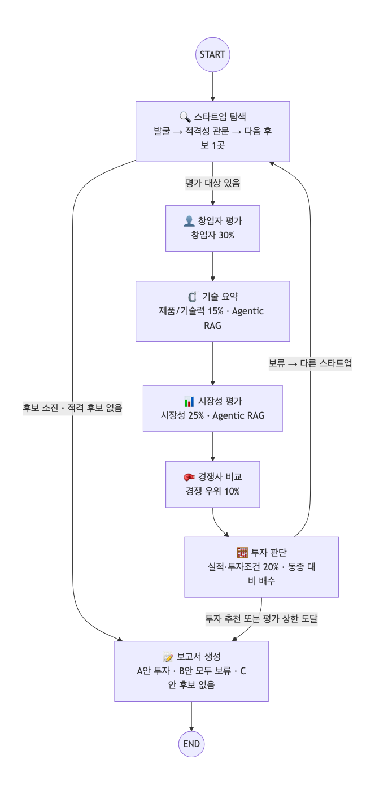

# AI Startup Investment Evaluation Agent
공개 정보만으로 AgTech AI 스타트업을 찾아 평가하고, 투자 · 보류 판단과 근거를 5쪽 이내 보고서로 만드는 LangGraph 멀티 에이전트입니다.

SKALA 울산캠퍼스 2반 1조 · [투자 보고서 PDF](outputs/RAG-Output_%EC%9A%B8%EC%82%B0-2%EB%B0%98_%EA%B9%80%EA%B0%80%EC%97%B0%2B%EA%B9%80%EC%A7%84%EB%85%95%2B%EB%AC%B8%EC%A7%80%ED%9B%84%2B%EC%9D%B4%EC%A4%80%ED%9D%AC%2B%EC%A0%95%EC%8A%B9%EC%9A%B0.pdf) · [설계서 PDF](docs/RAG-Design_%EC%9A%B8%EC%82%B0-2%EB%B0%98_%EA%B9%80%EA%B0%80%EC%97%B0%2B%EA%B9%80%EC%A7%84%EB%85%95%2B%EB%AC%B8%EC%A7%80%ED%9B%84%2B%EC%9D%B4%EC%A4%80%ED%9D%AC%2B%EC%A0%95%EC%8A%B9%EC%9A%B0.pdf)

> [!IMPORTANT]
> **메타파머스 투자 추천(실사 조건부)** — 동종 평균 100 대비 **109.6**, 창업자 기준 118.1, 동종 10곳 중 1위<br>
> 적격 14곳 중 10곳 평가 → 투자 기준 통과 3곳 중 1위 · 24문항 중 미확인 65% → 실사 5개 항목을 조건으로 추천

## Overview
- **Objective** : 비상장 · Seed\~Series C · Exit 전 AgTech AI 스타트업을 창업자 · 시장성 · 제품/기술 · 경쟁 · 실적 · 투자조건 6개 기준으로 평가해 **투자 / 보류** 판단
- **Method** : LangGraph Multi-Agent 7개 · Agentic RAG(문서 15종 199쪽 + 웹) · Scorecard(Payne) 동종 비교 + Bessemer 체크리스트 → 24문항
- **원칙** : LLM 은 원문 인용을 찾아 문항에 답만 하고, 인용 검증 · 점수 · 결정은 코드가 한다

## Features
- **후보 발굴 · 적격성 관문** : 공개 채널 8개에서 78곳 발굴 → 비상장 · 단계 · Exit 전 등 관문 G1\~G6 → 적격 14곳 (확인 못 하면 탈락)
- **Agentic RAG** : 질문마다 문서/웹 도구 선택 → 관련성 판정 → 질의 재작성(최대 2회) → 인용 답변 → 근거 점검
- **근거 없으면 '미확인'** : YES · NO 는 원문 인용이 있을 때만 인정, 날짜 · 제3자 · 회사명 규칙은 코드가 재검사
- **동종 비교 판정** : 투자 = 동종 평균(100) 초과 ∧ 창업자 점수 동종 평균 이상 ∧ Deal-killer 없음
- **보고서 자동 검사** : 5쪽 · SUMMARY 반 쪽 · REFERENCE 형식 · 평가표 일치를 PDF 렌더링 후 확인
- **키 없는 재현** : 검색 · LLM 응답 · 색인을 `replay/` 에 저장 → `python app.py` 한 줄로 같은 보고서

## Tech Stack
| 구분 | 사용 |
|---|---|
| Framework | LangGraph, LangChain (Python 3.11) |
| LLM / Generator · Judge | gpt-4.1-mini (temperature 0) |
| Retrieval | FAISS + Kiwi BM25 하이브리드 (BM25 0.4 : Dense 0.6, RRF) · Hit@4 0.986 · MRR@4 0.831 |
| Embedding | nlpai-lab/KURE-v1 (오픈소스, 후보 6종을 자체 질문 70개로 비교해 선정) |
| 외부 데이터 | Serper · Tavily 웹 검색, 한국거래소 KIND, 국민연금 사업장, TIPS |
| 보고서 | Jinja2 + Playwright (PDF) |

## Agents
| 에이전트 | 역할 | Scorecard 기준 |
|---|---|---|
| 스타트업 탐색 | 발굴 → 적격성 관문 → 다음 후보 1곳 | 관문 |
| 창업자 평가 (추가) | 창업 시점 t0 고정 → 창업 전 전문성 · 창업 후 24개월 실행력 | 창업자 30% |
| 기술 요약 | 핵심 기술 · 차별점을 분야 기술 기준선과 비교 (**Agentic RAG**) | 제품/기술 15% |
| 시장성 평가 | 하위 질문 3\~6개 × 문서/웹 선택 (**Agentic RAG**) | 시장성 25% |
| 경쟁사 비교 | 같은 제품 유형 경쟁사와 비교 | 경쟁 10% |
| 투자 판단 | 실적 · 투자조건 판정 → 동종 대비 배수 → 투자/보류 · 실사 항목 | 실적 10% · 투자조건 10% |
| 보고서 생성 | 5쪽 PDF, 형식 · 평가표 일치 검사 | — |

## Architecture


- 후보 1곳씩 탐색 → 창업자 → 기술 → 시장 → 경쟁 → 투자 판단, 판단 뒤 다음 후보로 (최대 10곳)
- 평가 상한 · 후보 소진 → 보고서. 대상은 투자 기준 통과 후보 중 동종 대비 배수 1위 (없으면 모두 보류 보고서)
- 상한 : 발굴 2라운드 · 평가 10곳 · RAG 재작성 2회 · recursion_limit 100

## Directory Structure
```text
├── app.py          # 실행 (재현 · 새 평가 · 보정)
├── config.yaml     # 모델 · 상한 · 판단 기준
├── rubric.yaml     # 평가표 24문항 · Deal-killer · 결정 규칙
├── agents/         # 에이전트 7개
├── graph/          # State · 메인 그래프 · 분기
├── rag/            # 청킹 · 임베딩 · 하이브리드 검색 · Agentic RAG
├── tools/          # 웹 검색 · 상장 목록 · 국민연금 · 근거 저장소
├── data/           # RAG 문서 15종 199쪽 · 동종 기준 집단 · 평가 정답
├── eval/           # 검색 · 적격성 · Judge · 양성 대조 평가
├── outputs/        # 보고서 PDF · 실행 로그 · 평가 결과
├── replay/         # 재현용 캐시
└── tests/
```

## Usage
```bash
python3.11 -m venv .venv && source .venv/bin/activate
pip install -r requirements.txt
python -m playwright install chromium
python app.py              # API 키 없이 제출 보고서 재현 → outputs/
```
- 새로 평가 (`.env` 에 `OPENAI_API_KEY`, `SERPER_API_KEY` 또는 `TAVILY_API_KEY`) : `python app.py --fresh --calibrate` → `python app.py --fresh`
- 테스트 : `python -m pytest`

### Supervisor 패턴 실험
`agtech-investment-add-Supervisor` 브랜치에서 `--supervisor`를 붙이면 각 에이전트가 작업 후 Supervisor로 돌아온다.
Supervisor는 현재 수집된 관점을 보고 LLM으로 다음 작업과 이유를 선택한다.
Agent-as-Tool과 Swarm은 사용하지 않으며, 각 에이전트는 기존 LangGraph 노드로 실행한다.
하위 에이전트는 Supervisor가 만든 입력만 받고 결과를 Supervisor로 반환한다. 하위 에이전트 간 직접 간선이나 호출은 없다.
선행 결과가 필요한 관점에는 Supervisor가 승인한 결과를 전달한다. 기술 분석 후 시장 분석,
창업자·기술 분석 후 경쟁 분석이라는 의존성을 지키면서 미수집 관점의 순서는 LLM이 선택한다.
관점이 모두 모이면 Supervisor가 문항별 판정·인용·실제 출처로 근거 충분성을 검토한다.
부족하면 담당 관점과 새로운 검색 질문을 지정해 재작업을 요청한다. 새 결과를 받은 뒤 충분성을 다시 검토한다.
선행 분석을 재작업하면 그 결과를 사용한 분석도 다시 수행한다. 시장 재조사에서는 이전 시장 분석 캐시를 재사용하지 않는다.
충분성이 승인된 후보만 투자 판단을 수행하고, 평가 후보 모두가 승인을 받았을 때 보고서 작성으로 분기한다.
재조사는 후보당 `supervisor.max_reworks_per_candidate`(기본 2회)로 제한한다. 이는 비용 한도이며 보고서 승인 조건이 아니다.
한도 소진 후에도 부족하면 `insufficient_evidence`로 종료하고 보고서를 작성하지 않는다(종료 코드 2).
중단된 보정 실행은 동종 비교 기준도 갱신하지 않는다.
평가 상한·투자 추천 시 종료·후보 소진·보정 모드는 기존 규칙을 따르되, 충분성 승인이 선행한다.
이는 LangGraph의 [구조화 출력 라우팅 방식](https://docs.langchain.com/oss/python/langgraph/workflows-agents)을 사용한다.

```bash
source .venv/bin/activate
python app.py --fresh --supervisor --calibrate
python app.py --fresh --supervisor --out outputs/supervisor_report
```

충분성 승인 시 보고서는 `outputs/supervisor_report/investment_report.pdf`에 저장한다.
실행 순서·재조사 질문은 같은 폴더의 `run_log.json`의 `log`, 후보별 충분성 판단은 `supervisor.reviews`,
최종 보고서 승인 여부는 `supervisor.final_review`에 남는다. 적격 후보가 없으면 탐색 결과만 보고하는 기존 분기를 사용한다.
재조사 한도가 소진돼 중단되면 부족 사유만 실행 로그에 남으며 이번 실행의 PDF는 생성되지 않는다.
기존처럼 `.env`에 OpenAI 키와 검색 키가 필요하다. `--fresh`는 `cache_fresh/`를 사용하므로 이미 저장된 결과는 재사용한다.
Supervisor 선택은 새 LLM 호출이라 제출용 `replay/`만으로 오프라인 재현되지 않는다.
분석 순서가 달라지면 기존 캐시가 맞지 않을 수 있다. `--supervisor` 없이 실행하면 기존 순차 그래프를 사용한다.
순차 실행보다 라우팅·충분성 검토·추가 검색 비용이 늘고, 충분성 판단은 LLM에 의존한다.
그 대신 핵심 근거가 부족한 상태에서 자동으로 보고서를 작성하는 것을 막고, 재조사 요청과 판단 이유를 추적할 수 있다.

## 투자 평가 결과
| 순위 | 후보 | 단계 · 지역 | 동종 평균 대비 | 창업자 기준 | 판정 |
|---|---|---|---|---|---|
| 1 | 메타파머스 | Pre-A · 국내 | 109.6 | 118.1 | **투자** |
| 2 | 에임비랩 | Pre-A · 국내 | 108.2 | 118.1 | **투자** |
| 3 | 새팜 | Pre-A · 국내 | 106.8 | 90.3 | 보류(창업자 점수 평균 미만) |
| 4 | 리비타 | Seed · 국내 | 101.2 | 104.2 | **투자** |
| 5 | Bonsai Robotics | Series A · 해외 | 98.2 | 104.2 | 보류(동종 평균 이하) |
| 6 | 퓨처커넥트 | Series A · 국내 | 97.8 | 90.3 | 보류(창업자 점수 평균 미만) |
| 7 | 트랙팜 | Seed · 국내 | 96.4 | 90.3 | 보류(창업자 점수 평균 미만) |
| 8 | 바르카 | Pre-A · 국내 | 96.4 | 104.2 | 보류(동종 평균 이하) |
| 9 | Upside Robotics | Seed · 해외 | 93.6 | 90.3 | 보류(창업자 점수 평균 미만) |
| 10 | Nature Robots | Seed · 해외 | 92.2 | 90.3 | 보류(창업자 점수 평균 미만) |

- **메타파머스 기준별** : 창업자·팀 118.1 · 시장성 108.3 · 제품/기술력 107.4 · 경쟁 우위 91.7 · 실적 95.8 · 투자조건 122.2
- **실사 확인 항목** : 최근 24개월 마일스톤 증빙 · 회사 공개 수치의 원자료 · 세부 분야 최근 2년 투자·도입 추이 · 농가 투자 회수기간(payback)·효과 실측 · PoC·시범이 아닌 유료 설치·계약 목록
- 적격 4곳은 평가 상한으로 미평가 · 결론은 2026-09-30 수집 자료 기준

## Evaluation
| 항목 | 결과 |
|---|---|
| 검색기 (70문항) | Hit@4 0.986 · MRR@4 0.831 |
| RAG 답변 (LLM Judge, 20문항) | Relevance 1.00 · Faithfulness 1.00 · Correctness 1.00 |
| 적격성 판정 | 0.95 (홀드아웃 1.00) |
| 양성 대조 (실제 투자받은 기업) | 3곳 중 추천 1곳 |
| 기준 민감도 | 100 → 3곳 · 105 → 2곳 · 110 → 0곳 · 115 → 0곳 · 120 → 0곳 |
| 보고서 형식 | 4쪽 · REFERENCE 11건 · 평가표 불일치 0건 |

## Lessons Learned
| 문제 | 바꾼 것 |
|---|---|
| 70점 · 110 같은 임의 기준은 근거를 댈 수 없었다 | Scorecard 원 방법의 기준점(동종 평균 100) |
| LLM 은 근거를 못 찾으면 NO 라고 썼다 | NO 에도 반대 사실의 원문 인용 요구 |
| 형식 검사는 통과해도 내용 오류가 있었다 | 인용 · 제3자 · 날짜 규칙을 코드로 |
| Hit@8 로 고른 검색기가 실제 설정(앞 4개)에선 1위가 아니었다 | 실제 동작 기준 Hit@4 · MRR@4 로 재선정 |
| 예정 투자 · 검색 실패가 조용히 통과했다 | 날짜 규칙과 fail-closed |
| 평가 대상 분야에 기준 문서가 없었다 | 문서 2종 추가, 200쪽 한도 안(199쪽) |

## 한계와 설계서 이후 변경
- 공개 정보 한계 : 추천 대상도 미확인 65%, 양성 대조 1/3 → 결론은 투자 결정이 아닌 **실사 대상 선별**
- 동종 기준 집단 10곳은 단계 · 지역이 섞인 근사
- **평가 흐름** : 설계서는 첫 투자 추천에서 멈춤 → 발굴 순서가 결론을 정하지 않도록 10곳 모두 평가 후 1위 선정
- **판단 기준 110 → 100** : 110 은 근거 없는 가정이라 원 방법 기준점으로. 결과가 나온 뒤의 변경이며, 110 결과(추천 0곳)도 민감도로 공개
- RAG 문서 13종 196쪽 → 15종 199쪽

## Contributors
- 김가연 : 설계서 검토, 스타트업 발굴·적격성 검증 구현, 투자 판단 구현, 적격성 정답 라벨 검수, 보고서 사실 확인, 가이드 정렬 점검, 재현성 테스트, README 검토
- 김진녕 : 도메인·에이전트·State·평가표·보고서 목차 설계, RAG 문서 선정·임베딩 비교·Agentic RAG, 에이전트 구현(발굴\~보고서)·그래프·실행 스크립트, 검증(정답 라벨·보고서 사실·형식·가이드 정렬), 재현성 테스트, 제출, 발표 (AI 코딩 도구 활용)
- 문지후 : State·그래프 설계, 임베딩 후보 선정·비교, Agentic RAG 구현, 투자 판단 구현, 그래프 조립·실행 스크립트, 보고서 사실·형식 확인, 재현성 테스트
- 이준희 : State·그래프 설계, 문서 전처리·청킹, Agentic RAG 구현, 창업자·기술·시장성·경쟁사 분석 에이전트 구현, 그래프 조립·실행 스크립트, 재현성 테스트
- 정승우 : 도메인 선정·문제 정의, 에이전트 역할 설계, 투자 평가표 설계, 보고서 목차 설계, RAG 문서 수집·선정, 보고서 생성 구현, 가이드 정렬 점검
